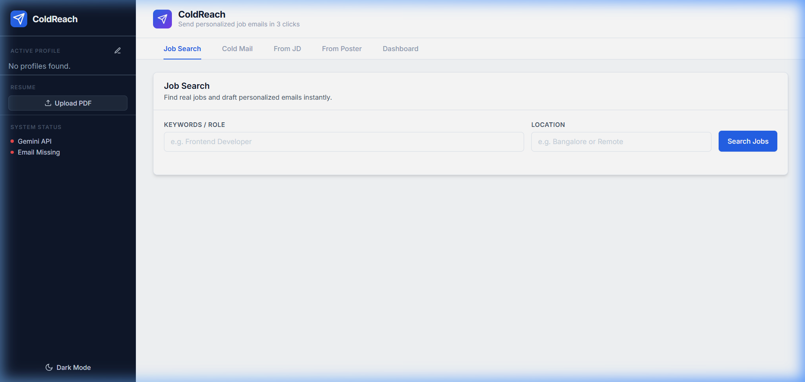

# ColdReach

**ColdReach** is an AI-powered, multi-profile cold emailing and job application tracking platform. It leverages Google's Gemini models to instantly parse job descriptions, LinkedIn flyers, and HR lead documents (PDF & Word), mapping them directly to your uploaded resume to generate highly personalized, human-sounding outreach and follow-up emails.

Built with a sleek, Linear-inspired SaaS aesthetic, it prioritizes speed, intelligent context matching, and full user control so you can focus on securing interviews without repetitive manual work.



## Core Features

- **Resume-Driven Intelligence:** Upload your PDF resume once. Gemini extracts your skills and experiences and intelligently maps them to Job Descriptions and company targets without hallucinating.
- **Vision & Document Lead Parser:** 
  - Upload screenshot flyers to extract recruiter emails and role details.
  - Upload whole **PDF or Word (`.docx`/`.doc`)** lead sheets to bulk-extract roles, companies, HR contacts, and required skills for 1-click personalized drafting.
- **Dual-Mode Follow-ups:** Automatically tracks application age (3d, 7d, 14d) while offering a **"Force Follow-up Now"** override anytime you want to dispatch a follow-up immediately.
- **Multi-Recipient Email Support:** Automatically validates and delivers emails to multiple comma-separated recruiter addresses in one go.
- **AI HR Reply Assistant:** When an HR recruiter replies, ColdReach references the previous thread history and your instructions to draft and send tailored responses.
- **Cold Mail History & Templates:** Quick-access sidebar of past outreach contacts with options to generate a fresh AI draft or instantly reuse an exact previous draft.
- **Contextual Resends:** Didn't get a reply? Resend with a new angle (e.g., *"Highlight cloud architecture experience"*) and the AI restructures the outreach.
- **Multi-Profile Support:** Manage multiple job search personas (e.g., AI Engineer vs. Full Stack Developer) with seamless profile switching.
- **Application Dashboard:** Filterable, paginated (10/20/50/All), and searchable application tracker with status workflows (Draft, Sent, Follow-up Sent, Replied, Interview Scheduled, Ghosted, Rejected).
- **Batch Operations & CSV Export:** Clean up drafts/replied/ghosted entries in bulk or export your entire pipeline to CSV.

---

## 📖 How to Use ColdReach

ColdReach gives you full control over every email drafted and sent:

### Step 1: Initial Setup
1. Open the **Profile Manager** (bottom of the sidebar) to add your Name, GitHub, Portfolio, and LinkedIn URLs.
2. Go to **Settings** and upload your **Resume (PDF)**.

### Step 2: Generating Outreach Emails
Choose from 4 ways to generate tailored applications:
- **Cold Mail:** Reach out directly to a company or recruiter. Pick past contacts from the history sidebar to reuse templates or generate fresh angles.
- **From JD:** Paste a full Job Description. ColdReach cross-references requirements with your resume to highlight your top matching skills.
- **From Poster:** Upload an image flyer or screenshot to extract the contact info and role automatically.
- **HR Leads Auto-Mailer (Sidebar):** Upload a document (`.pdf`, `.docx`, `.doc`) containing multiple job leads. Review extracted roles, companies, HR emails, and skills, then click **Auto-Draft** to generate each outreach.

### Step 3: Manage & Follow Up
- **Review & Edit:** Tweak recipients (supports comma-separated emails), subjects, and bodies before sending.
- **Send with 1-Click:** Emails are dispatched through your configured Gmail account with your resume automatically attached.
- **Follow-up:** Follow the automated cadence or use **Force Follow-up Now** to trigger follow-up emails whenever needed.
- **HR Replies:** Switch status to `Replied` to draft and send context-aware replies.

---

## 🛠️ Getting Started (Installation)

### Prerequisites
- Node.js (v18+)
- Python 3.10+
- A Google Gemini API Key
- A Gmail account with an **App Password**

### 1. Clone & Setup
```bash
git clone https://github.com/just000Curious/ColdReach-.git
cd ColdReach-
```

### 2. Configure Environment
Copy the example environment file and add your credentials:
```bash
cp .env.example .env
```
Inside `.env`:
- `GEMINI_API_KEY`: Your Gemini API Key from Google AI Studio.
- `EMAIL_SENDER_ADDRESS`: Your sending Gmail address.
- `EMAIL_APP_PASSWORD`: Your 16-character Google App Password.

### 3. Quick Launch (Windows)
Double-click `Start_ColdReach.bat` to launch both backend and frontend servers and automatically open the application in your browser.

### 4. Manual Launch
**Backend:**
```bash
pip install -r requirements.txt
python -m uvicorn server:app --reload --port 8000
```

**Frontend:**
```bash
cd frontend
npm install
npm run dev
```

Visit `http://localhost:5173/` in your browser.

---

## Security
ColdReach is built to run entirely locally. Your API keys, App Passwords, uploaded resumes, and application databases never leave your machine and are never exposed to external servers beyond official Google Gemini endpoints.

## License
MIT License
